<!-- opening:start -->

<!-- workshop:start -->
<picture>
  <source media="(max-width: 600px)" srcset="assets/workshop-mobile-dark.svg">
  <source media="(prefers-color-scheme: dark)" srcset="assets/workshop-dark.svg">
  
</picture>
<!-- workshop:end -->
<picture>
  <source media="(prefers-color-scheme: dark)" srcset="assets/stats-dark.svg">
  
</picture>

<!-- opening:end -->

<!-- activity-scope:start -->
Commits: public + private, all branches. Lines of code: added − deleted. Line totals exclude commits over 10,000 changed lines.
<!-- activity-scope:end -->

<!-- socials:start -->

<a href="mailto:mknsltnw@gmail.com" title="mknsltnw@gmail.com">Email</a> · <a href="https://x.com/0xsolt" title="@0xsolt">X</a> · <a href="https://www.linkedin.com/in/mekan-soltanov-31986097" title="mekan-soltanov">LinkedIn</a>

<!-- socials:end -->

### On the workbench

<!-- projects:start -->

<picture>
  <source media="(prefers-color-scheme: dark)" srcset="assets/project-1-dark.svg">
  
</picture>
<h4><a href="https://github.com/msoltanov/pdf-shrinker">pdf-shrinker</a></h4>

Compress PDF files with Ghostscript via cli

 

<picture>
  <source media="(prefers-color-scheme: dark)" srcset="assets/project-2-dark.svg">
  
</picture>
<h4><a href="https://github.com/msoltanov/ikea-like-name-generator">ikea-like-name-generator</a></h4>

Name generator like ikea namings for fun purpose

 

<picture>
  <source media="(prefers-color-scheme: dark)" srcset="assets/project-3-dark.svg">
  
</picture>
<h4><a href="https://github.com/msoltanov/hackernews-agent-skills">hackernews-agent-skills</a></h4>

Read-only Hacker News research skills with source checks and submission reviews.

 

<picture>
  <source media="(prefers-color-scheme: dark)" srcset="assets/project-4-dark.svg">
  
</picture>
<h4><a href="https://github.com/msoltanov/Proxmox-Technical-Writing-Style-Skill">Proxmox-Technical-Writing-Style-Skill</a></h4>

Unofficial Proxmox Technical Writing Style Skill

 

<!-- projects:end -->

### Languages

<picture>
  <source media="(prefers-color-scheme: dark)" srcset="assets/languages-dark.svg">
  
</picture>

<!-- environment:start -->

### My toolbox

<table>
<thead><tr><th scope="col">Group</th><th scope="col">Tools</th></tr></thead>
<tbody>
<tr><th scope="row">Workspace</th><td>Windows 11 · Linux</td></tr>
<tr><th scope="row">Editors</th><td>VS Code · JetBrains IDEs · Pulsar</td></tr>
<tr><th scope="row">Terminals</th><td>Tabby · Termius</td></tr>
</tbody>
</table>

More tools &amp; background

<strong>Programming</strong> Python · TypeScript · JavaScript · Go · Rust (learning)

<strong>Mobile</strong> Android 13-14 · Kotlin · Flutter · Dart

<strong>Configuration &amp; scripting</strong> JSON · YAML · TOML · Lisp · Lua · Perl

<strong>Earlier experience</strong> PHP · C · Java

<strong>Human languages</strong> Turkmen · Turkish · English

<!-- environment:end -->
